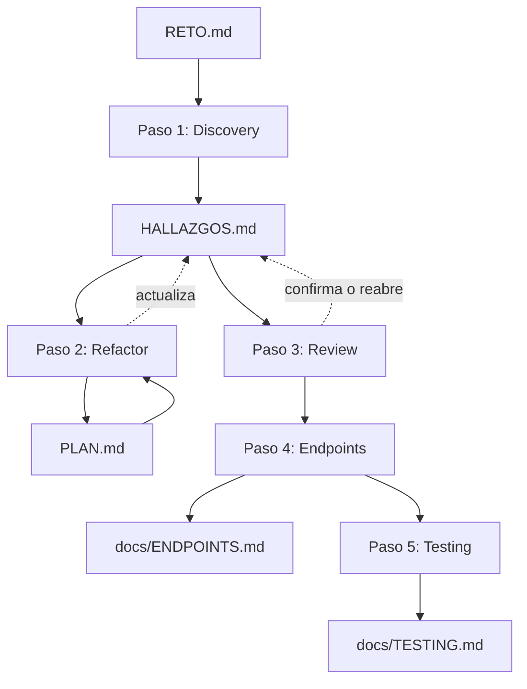

# BCP AI Lab — Día 01


Programa Train-the-Trainers IA · NTT DATA Perú × BCP.

Hoy trabajas con **GitHub Copilot en VS Code (modo Agent)** sobre
**ReqFlow**, el portal interno de **Nuvexa Andina Digital S.A.** (empresa
ficticia, el caso integrador del programa): 3 aplicaciones chiquitas y
reales, conectadas entre sí, que tienen errores y huecos de seguridad
puestos a propósito. La idea: aprender a pedirle cosas a la IA con prompts
claros, y a no confiar ciegamente en lo que te devuelve. Es el mismo stack
de IA de los 4 días (Claude Code u otro asistente con acceso a archivos
sirve solo para los prompts copy-paste de hoy; del Día 2 en adelante se
usa Copilot).

## Material de la sesión

[Descargar la presentación del Día 1 (PDF)](BCP_Formacion_IA_Train_the_Trainers_DIA1.pdf).

## Objetivo del día

Salir con tu `reqflow-workspace/` creado (3 repos propios) y los artefactos que alimentan todo el programa: `HALLAZGOS.md` con hallazgos trazables (Id `H-xx`, al menos uno "Pendiente"), `prompts/` con lo que te funcionó, `docs/ENDPOINTS.md` y `docs/TESTING.md`. Cierras con el tag `day1-done` y `check_handoff.py --day 1` en verde: eso es la entrada del Día 2. Rúbrica: [EVALUACION-D1.md](EVALUACION-D1.md).

Este repo **no tiene código** — es la guía y los prompts. El código vive en
3 repos aparte que clonas en el siguiente paso.

## Requisitos del sistema

- Git instalado y disponible en PATH.
- VS Code con GitHub Copilot en modo Agent para correr
  los prompts.
- Java 21 + Maven 3.9+ (backend de autenticación).
- Python 3.13 (API de tareas y requerimientos).
- Node.js 22.12+ (frontend).
- Un navegador para abrir `laboratory-guide.html`.

Si `mvn --version` no responde, instala Maven 3.9+ antes de levantar el
backend. En las máquinas del taller, donde Chocolatey ya está instalado:

```powershell
# Abre PowerShell como Administrador antes de ejecutar este comando.
choco install maven -y
```

Cierra y abre una terminal nueva, y verifica con `mvn --version`. Requiere que
Java 21 esté instalado y disponible en `PATH`.

¿No quieres instalar Java/Python/Node? Ver [PODMAN_SETUP.md](PODMAN_SETUP.md)
para levantar los 3 servicios con contenedores (Podman o Docker).

No hay LLM propio ni servidores MCP que levantar: los prompts se pegan
directo en Copilot Chat.

## Cómo empezar

**1. Crea tu workspace con 3 repos propios.** Desde la carpeta del curso
(la que contiene este laboratorio), crea `reqflow-workspace/` **al lado** de
`bcp-ai-lab-day-01`. Es la carpeta que vas a usar **los 4 días**: lo que produces hoy es la entrada del
Día 2, y así hasta el Día 4. Las plantillas del trainer no se modifican ni se
pueden forkear, así que cada repo se clona, se desvincula y se publica bajo tu
owner (`<OWNER>` = tu usuario de GitHub, o el que indique el trainer).

```powershell
# Desde la carpeta del curso (donde está bcp-ai-lab-day-01)
mkdir reqflow-workspace
cd reqflow-workspace

foreach ($r in "workshop-auth-backend", "workshop-requirements-api", "workshop-login-frontend") {
    git clone --branch main --single-branch "https://github.com/NTTData-Academy/$r-template.git" $r
    git -C $r remote remove origin
    gh repo create "<OWNER>/$r" --private
    git -C $r remote add origin "https://github.com/<OWNER>/$r.git"
    git -C $r push -u origin HEAD
}
```

No uses `--depth 1`: el repo nuevo necesita el historial completo. Comprueba
con `git -C workshop-auth-backend remote -v` que `origin` apunta a tu repo y no
a la plantilla.

El árbol debe quedar así:

```text
<carpeta-del-curso>/
├── bcp-ai-lab-day-01/            ← guías, prompts y scripts (uno por día)
├── bcp-ai-lab-day-02/ … 04/
└── reqflow-workspace/            ← SOLO el producto: aquí abres VS Code
    ├── workshop-auth-backend/
    ├── workshop-requirements-api/
    └── workshop-login-frontend/
```

Los laboratorios quedan **fuera** del workspace a propósito: el asistente de IA
lee todo lo que hay en la carpeta abierta, y los labs traen ejemplos y
soluciones de referencia.

**2. Levanta los 3 servicios**, en 3 terminales abiertas en `reqflow-workspace/`, en este orden:

```bash
# Backend de autenticación
cd workshop-auth-backend
mvn quarkus:dev

# API de tareas y requerimientos
cd workshop-requirements-api
python -m venv .venv && source .venv/bin/activate   # Windows: .venv\Scripts\activate
pip install -r requirements.txt -r requirements-dev.txt
uvicorn app.main:app --host localhost --port 8000 --reload

# Frontend
cd workshop-login-frontend
npm install
npm start
```

Verifica que los 3 respondan antes de seguir:

```bash
curl http://localhost:8080/q/health
curl http://localhost:8000/docs
curl http://localhost:4200
```

```powershell
Invoke-WebRequest http://localhost:8080/q/health
Invoke-WebRequest http://localhost:8000/docs
Invoke-WebRequest http://localhost:4200
```

Si alguno no responde, revisa la terminal correspondiente: el error suele estar ahí (puerto ocupado, falta una dependencia, etc.).

Abre `http://localhost:4200` y entra con `student` / `Workshop123!` (o
`trainer` / `Trainer123!`).

**3. Abre `laboratory-guide.html`** en el navegador. Ahí están los 5 pasos del
día, cada uno con su prompt completo listo para copiar y pegar, en el orden
en que se usan.

Eso es todo lo que necesitas para arrancar. El resto de este README es
referencia, por si después necesitas entender cómo está armado todo.

## Los 3 servicios

```
Angular (4200)  --login-->  Quarkus auth-backend (8080)
      |                              ^
      |  Bearer token                | valida token
      v                              |
Python FastAPI requirements-api (8000) --health--> consulta 8080
```

| Servicio | Stack | Qué hace |
|---|---|---|
| [workshop-auth-backend](https://github.com/NTTData-Academy/workshop-auth-backend-template) | Java 21 + Quarkus | Login. El único que sabe quién eres. |
| [workshop-requirements-api](https://github.com/NTTData-Academy/workshop-requirements-api-template) | Python + FastAPI | Tareas y carga de archivos. |
| [workshop-login-frontend](https://github.com/NTTData-Academy/workshop-login-frontend-template) | Angular | Lo que ves en pantalla: login + dashboard. |

Cada repo clonado trae su código y 3 archivos de referencia:

- `REGLAS.md` — lineamientos del laboratorio.
- `RETO.md` — la lista de hallazgos que tienes que encontrar.
- `docs/GOOD_PRACTICES.md` — a qué convenciones tiene que llegar tu código.

`HALLAZGOS.md`, `PLAN.md` y `docs/TESTING.md` no vienen en el clon: los
genera la IA cuando ejecutas los prompts correspondientes. Con
`docs/ENDPOINTS.md` pasa lo mismo: si el clon no lo trae, el Paso 1 lo
genera a partir del código (el contrato legacy, con sus defectos) y el
Paso 4 lo actualiza al contrato final.

## Los 5 pasos del día, con sus prompts

Los prompts ya están escritos, listos para copiar — están en
`laboratory-guide.html` y también en [`ejercicios/`](ejercicios/), un archivo
por paso, organizados por repo (`auth-backend/`, `frontend/`,
`requirements-api/`).

| Paso (orden de ejecución) | Módulo (biblioteca de metodología) | Qué hace |
|---|---|---|
| 1 | [`s2_secure_ai/`](s2_secure_ai/README.md) | Encontrar los hallazgos de `RETO.md` en el código real |
| 2 | [`s3_refactor/`](s3_refactor/README.md) | Corregirlos: primero un plan, después el código |
| 3 | [`s2_secure_ai/`](s2_secure_ai/README.md) | Revisar que la corrección esté bien hecha |
| 4 | [`s4_docs_testing/`](s4_docs_testing/README.md) | Documentar el contrato final (`docs/ENDPOINTS.md`) |
| 5 | [`s4_docs_testing/`](s4_docs_testing/README.md) | Escribir las pruebas que falten (`docs/TESTING.md`) |
| extra | `resolver-item.md` | Resolver un hallazgo suelto, en cualquier momento después del paso 2 |
| extra | `template.md` | El framework de 5 partes, para cualquier otro pedido que se te ocurra |

`ejercicios/<repo>/` tiene los 7 archivos de arriba, todos juntos, listos
para ese repo puntual — no hace falta ir a buscarlos a otro lado.

Los Pasos 1–5 son el orden de ejecución del día; las carpetas `s1_`–`s4_` son la biblioteca de metodología (por eso el Paso 1 usa el módulo `s2_`, el Paso 2 el `s3_`, etc.). `s1_prompting/` es el framework transversal de 5 partes, no un paso.

Abre VS Code con Copilot en modo Agent sobre
`reqflow-workspace/`, no sobre un repo suelto: es el contexto de los 4 días.
Por eso cada prompt empieza con un bloque **AMBITO** que lo limita a la
carpeta del track (`workshop-requirements-api/`, etc.). Sin él, el asistente
puede mezclar evidencia de los otros repos o escribir `HALLAZGOS.md` en la
raíz del workspace, que no es un repo.

Cada paso no arranca de cero: consume el archivo que generó el paso anterior.



## Cierre del día: handoff al Día 2

Lo que produces hoy **es la entrada del Día 2**: los hallazgos que quedan
"Pendiente" se convierten en historias de usuario, y los prompts que te
funcionaron se convierten en Skills. No borres nada al terminar.

En cada repo que trabajaste:

1. Guarda en `prompts/` los prompts que usaste y te funcionaron (copia el
   bloque de texto, con tus ajustes), un archivo por prompt, por ejemplo
   `prompts/1-discovery.md`.
2. Deja en `HALLAZGOS.md` al menos una fila "Pendiente" (si las resolviste
   todas, perfecto, pero entonces el Día 2 usará las HU de referencia).
3. Haz commit y marca el cierre:

```bash
git add HALLAZGOS.md PLAN.md docs/ prompts/
git commit -m "day1: hallazgos, contrato y pruebas"
git tag day1-done
git push --follow-tags
```

Verifica el handoff desde la carpeta del laboratorio (necesitas al menos 1 repo en `[OK]`):

```bash
python tools/check_handoff.py --day 1 ../reqflow-workspace
```

| Artefacto | Lo usa el Día 2 en |
|---|---|
| `HALLAZGOS.md` (filas "Pendiente", con su Id `H-xx`) | S1/S2: se generan `HU-xx.md`. S3: un issue por HU en el Project ReqFlow |
| `prompts/*.md` | S1: ejemplo de entrada del Skill |
| `docs/ENDPOINTS.md` | S2: base del contrato API |
| `docs/TESTING.md` | S2: base de la matriz de pruebas |

Si no llegaste a completar ningún repo, el instructor entrega la rama
`checkpoint/day1` con el estado mínimo para empezar el Día 2.

## Roles

Chapter, Backend, Frontend, Cyber, Líder Técnico, QA, PO/PM y LT aprobador —
cada uno participa en los 3 repos según lo que le toque revisar o construir.
`3-review.md` asume que quien revisa puede no ser quien programó.

¿Cómo repartir estos 8 roles según cuántos estudiantes hay? Ver [ROLES.md](ROLES.md).

## Si quieres aplicar esta metodología a otro proyecto (no el de hoy)

Todo lo que está fuera de `ejercicios/` (`REGLAS.md`, `s1_prompting/`,
`s2_secure_ai/`, `s3_refactor/`, `s4_docs_testing/`) es la misma metodología
pero en blanco, con placeholders entre `[ ]`, para copiarla a un repo nuevo.
No la necesitas para el laboratorio de hoy.

Copia, en este orden:

1. [`REGLAS.md`](REGLAS.md) → a la raíz de tu repo nuevo.
2. [`s1_prompting/template.md`](s1_prompting/template.md) → el framework de
   5 partes.
3. [`s2_secure_ai/discovery.md`](s2_secure_ai/discovery.md) y
   [`review.md`](s2_secure_ai/review.md) → a `prompts/` de tu repo.
   [`HALLAZGOS.md`](s2_secure_ai/HALLAZGOS.md) no se copia vacío: lo genera
   `discovery.md` la primera vez que lo ejecutas.
4. [`s3_refactor/GOOD_PRACTICES.md`](s3_refactor/GOOD_PRACTICES.md) → a
   `docs/` de tu repo, **antes** de refactorizar.
   [`refactor.md`](s3_refactor/refactor.md) y
   [`resolver-item.md`](s3_refactor/resolver-item.md) → a `prompts/`.
5. [`s4_docs_testing/endpoints.md`](s4_docs_testing/endpoints.md) y
   [`testing.md`](s4_docs_testing/testing.md) → a `prompts/` de tu repo.

Reemplaza los placeholders por lo real de tu proyecto en cada uno.

---

NTT DATA Perú · Digital Architecture · Programa Train-the-Trainers IA BCP
