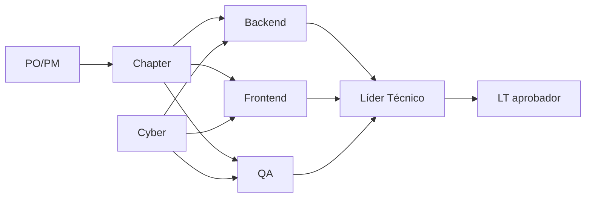

# Cómo repartir los 8 roles según el tamaño del grupo

Los 8 roles ya están descritos en `laboratory-guide.html` ("Tu rol hoy"). Esto es solo
la parte que faltaba: cuántas personas por rol según cuántos estudiantes llegan,
y quién depende de quién.

## Quién depende de quién

PO/PM enmarca el problema de negocio → Chapter prioriza entre los 3 repos →
Backend/Frontend/QA resuelven cada uno el suyo, con Cyber revisando seguridad en
los 3 → Líder Técnico revisa que nada se rompió entre repos → LT aprobador
decide al final si el día queda aprobado (rúbrica).

## 6 estudiantes

| Rol | Personas |
| --- | --- |
| Backend | 1 |
| Frontend | 1 |
| QA | 1 |
| Cyber | 1 |
| Chapter + PO/PM (misma persona) | 1 |
| Líder Técnico | 1 |
| LT aprobador | el trainer |

## 12 estudiantes

| Rol | Personas |
| --- | --- |
| Backend | 2 |
| Frontend | 2 |
| QA | 2 |
| Cyber | 2 |
| Chapter | 1 |
| PO/PM | 1 |
| Líder Técnico | 1 |
| LT aprobador | 1 (o el trainer) |

## 18 estudiantes

| Rol | Personas |
| --- | --- |
| Backend | 3 |
| Frontend | 3 |
| QA | 3 |
| Cyber | 2 |
| Chapter | 2 |
| PO/PM | 2 |
| Líder Técnico | 2 |
| LT aprobador | 1 (o el trainer) |

## Regla simple

Asigna los roles **antes** de arrancar el día, no sobre la marcha. Con grupos
chicos (6), combina roles en vez de dejar alguno sin cubrir.
